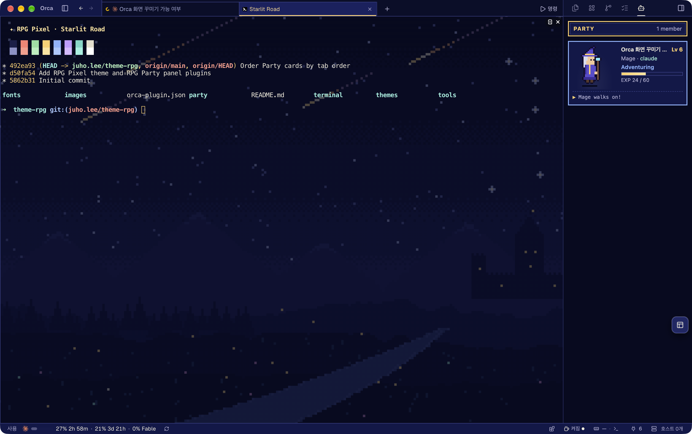

# RPG Pixel

16비트 RPG 밤 분위기의 Orca 테마와, 에이전트를 픽셀 파티원으로 보여주는 Party 패널입니다. 테마는 남색·크림·금색 색상, 터미널 뒤에 깔리는 픽셀 배경(별밤 길, 유성, 먼 성), 선택용 픽셀 폰트 Galmuri로 구성됩니다.



## 1. 구성

| 항목 | 파일 | 내용 |
|---|---|---|
| 앱 테마 | `themes/starlit-road.json` | 공개 토큰 73종 전체, 코드 문법 색, 배경 이미지 |
| 터미널 팔레트 | `terminal/starlit-road.json` | ANSI 16색, 커서, 선택 영역 |
| 배경 | `images/starlit-road.png` | 2560×1440. `tools/gen_background.py`가 320×180 격자로 그린 뒤 8배 확대 |
| 폰트 (선택) | `fonts/*.woff2` | Galmuri11(400, 700), GalmuriMono11(400) |
| Party 패널 | `party/` | 별도 플러그인. 코드가 실행되므로 설치할 때 승인 필요. [party/README.md](party/README.md) |

## 2. 적용 방법 (AI 에이전트에게 맡기기)

Orca 터미널에서 실행 중인 Claude Code나 Codex에게 아래 문장을 그대로 붙여 넣어주세요. 에이전트는 Orca CLI(`orca`)로 설치하고, 설정 화면 조작은 `orca computer`로 하거나 사람에게 요청합니다.

```text
https://github.com/leeiopd/orca-rpg-theme 의 Orca 테마를 적용해줘.
1. 저장소를 ~/orca-plugins/orca-rpg-theme 에 clone 해 (비공개 저장소라 gh 로그인 계정으로 접근).
2. `orca plugin install ~/orca-plugins/orca-rpg-theme --json` 으로 테마 플러그인을 설치해.
3. Party 패널도 쓸 거면 `orca plugin install ~/orca-plugins/orca-rpg-theme/party --json` 을 실행하고,
   approval_required 가 나오면 요청 권한 목록을 나에게 보여준 뒤 내가 승인하면 --approve 로 다시 실행해.
4. Orca Settings > 모양에서 다크 테마와 터미널 어두운 테마를 "RPG Pixel: Starlit Road" 로 선택해.
5. "배경 불투명도"를 0.6 으로 바꾸고 Tab 을 눌러 저장한 뒤, 설정을 다시 열어 값이 남았는지 확인해.
6. 화면을 캡처해서 테마 색, 터미널 뒤 배경 그림, Party 패널이 보이는지 확인하고 결과를 알려줘.
```

에이전트가 지켜야 할 점과 확인할 점입니다.

| 단계 | 확인할 점 |
|---|---|
| 테마 설치 | 테마는 실행 코드가 없는 data 플러그인이라 승인 없이 설치됩니다 |
| Party 설치 | `storage:own`, `agent:read`, `workspace:read` 권한과 `agent.tool.after` 훅을 요청합니다. 사람이 승인하기 전에 `--approve`를 실행하면 안 됩니다 |
| 테마 선택 | 플러그인을 설치해도 테마는 자동으로 바뀌지 않습니다. Settings에서 선택해야 합니다 |
| 배경 불투명도 | 입력란에 값만 넣으면 저장되지 않습니다. Enter나 Tab으로 확정해야 합니다. 1이면 터미널이 배경을 가립니다 |
| 배경이 안 보일 때 | "Reduce visual effects"가 꺼져 있는지 확인합니다. 설정 전에 열린 터미널은 새 탭으로 비교합니다 |
| 폰트 | 픽셀 폰트는 긴 본문과 한글을 읽기 어려우므로 기본 폰트를 권장합니다. 쓰려면 Settings에서 `Galmuri11`, `GalmuriMono11`을 고르고 11px 또는 22px로 맞춥니다 |

### 2.1 직접 적용하기

에이전트 없이 적용할 때는 같은 순서를 직접 진행합니다.

```sh
gh repo clone leeiopd/orca-rpg-theme ~/orca-plugins/orca-rpg-theme
orca plugin install ~/orca-plugins/orca-rpg-theme
orca plugin install ~/orca-plugins/orca-rpg-theme/party   # 선택. 표시되는 권한을 확인한 뒤 --approve
```

이어서 Settings > 모양에서 테마 2개를 선택하고, 배경 불투명도를 0.6으로 바꾼 뒤 Tab을 눌러 저장합니다.

## 3. 개발

```sh
orca plugin validate . --json
orca plugin dev watch .        # 폴더를 Orca에 불러오고 저장할 때마다 다시 불러옴. Ctrl-C로 해제
python3 tools/gen_background.py images/starlit-road.png   # 배경 다시 그리기 (표준 라이브러리만 사용)
```

Party 패널 개발 명령은 [party/README.md](party/README.md)에 있습니다.

## 4. 출처와 라이선스

- **배경 이미지와 캐릭터**: `tools/gen_background.py`와 `party/src/sprites.ts`가 코드로 그린 원본 그림입니다. 외부 이미지를 쓰지 않았습니다.
- **폰트**: [Galmuri](https://github.com/quiple/galmuri) v2.40.4, Copyright (c) 2019–2025 Lee Minseo (quiple). SIL Open Font License 1.1로 배포되며, 원문은 `fonts/OFL-Galmuri.txt`에 있습니다. 릴리스 파일을 수정 없이 포함했습니다.
- **색감 참고**: Herdr 레이아웃 [CHO-kr/frieren](https://github.com/CHO-kr/frieren)의 Frieren Pixel 분위기를 참고했습니다. 색 값은 이 테마용으로 새로 정했고, 해당 저장소의 이미지·코드는 포함하지 않았습니다.
